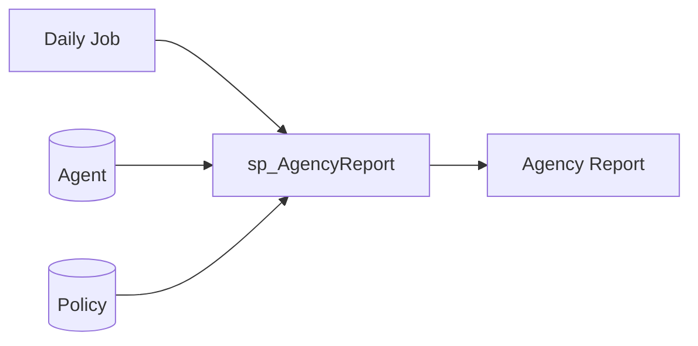

You are stuck mainly for three reasons:

“Architecture” and “Data flow” are two different things. When you ask the agent to do both at once, it tends to make both diagrams unclear.

Architecture = the big picture: which job / app calls this SP → which tables the SP reads or writes → which report receives the output

Data flow = the step-by-step processing inside the SP: read tables → JOIN → WHERE → calculate → output

Your SP has already been changed, so there is no need to analyse it from scratch. Review the diff first (what differs between OLD and SOLUTION), then draw the diagrams based on those changes. This will be much faster.

The agent may not be able to read Word documents. It is recommended to save the NSC transition plan as a .txt or .md file and place it in the top-level directory.

The diagram should look like this (Architecture example):



Use the same format for the To-Be diagram. Highlight changed parts in red, then place the two diagrams side by side so they can be compared at a glance.

## Five prompts — run them in order and review each result before moving to the next

### P1 — Find the changes first (most important; all later steps depend on this)

```text
Compare OLD/ vs SOLUTION/ for every SP. Read CR/ and
NSC transition plan for context. Do not modify any code.

Create REPORT/01_changes.md:
| # | SP | Line | Before | After | Which CR requirement |
Only list real logic changes, ignore spacing/comments.
```

### P2 — Existing state before the change (As-Is)

```text
Using OLD/ SPs and REPORT/01_changes.md, create REPORT/02_as_is.md:

1. Architecture (Mermaid flowchart LR):
   caller job/app → SP → source tables → output/report
2. Data flow (Mermaid flowchart TD), one per SP:
   read tables → JOIN → WHERE → calculation → output
3. Short table: | Step | Table | Logic | Line |

Search DATABASE/ for callers. If not found, mark UNKNOWN.
Max 1 page per SP.
```

### P3 — Existing state after the change (To-Be)

```text
Same format as REPORT/02_as_is.md, but using SOLUTION/.
Create REPORT/03_to_be.md.
Highlight changed nodes in red:
  style <node> fill:#f99
Add one table: | Item | As-Is | To-Be | Reason |
```

### P4 — Impact analysis

```text
Based on REPORT/01_changes.md, search DATABASE/ for every
SP, view, or job that uses the changed SPs or tables.

Create REPORT/04_impact.md:
| Object | How it is affected | Risk H/M/L | Need test? |
Check: output columns, row count, calculation result changes.
```

### P5 — Test cases + read-only SQL

Based on CR/, REPORT/01_changes.md and REPORT/04_impact.md:

**A) REPORT/05_test_cases.md**

```text
| Test-ID | Change # | Scenario | Expected (from CR) | Status |
For each change: normal, boundary, NULL, no-change regression.
```

**B) TEST/uat_queries.sql**

```sql
SELECT only. Each query has a comment: Test-ID + expected result.
Include a before/after compare query where possible.
```

## Time-saving tips

You must review P1 yourself: P2 through P5 all depend on it. If P1 is wrong, everything that follows will be wrong.

If a diagram is too cluttered, tell the agent: `Simplify the diagram to max 8 boxes.`

If time is really tight, at minimum do P1, P4 and P5, because these three are needed to create test cases. The P2 and P3 diagrams can be added after UAT.
