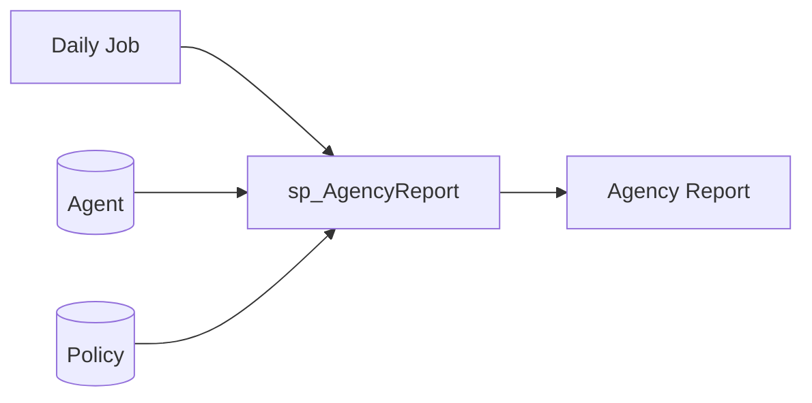

你卡住，主要係因為三個原因：

「Architecture」同「Data flow」係兩樣嘢，一齊叫 agent 做，佢就會兩樣都畫得唔清楚

Architecture = 大局：邊個 job / app call 呢個 SP → SP 讀寫邊啲 table → 輸出去邊個 report

Data flow = SP 入面一步步點樣處理資料：讀 table → JOIN → WHERE → 計算 → 輸出

你嘅 SP 已經改好，唔使由零開始分析。應該先睇 diff（OLD 同 SOLUTION 有咩唔同），再按住改動畫圖，會快好多

Word 文件 agent 未必讀得到：建議將 NSC transition plan 另存做 .txt 或者 .md，放喺最外層

畫出嚟應該係咁樣（Architecture 例子）：



To-Be 張圖用同一個格式，將改咗嘅部分標紅，兩張擺埋一齊對比就一目了然。

## 5 個 prompt，順序做，每個做完睇一睇先做下一個

### P1 — 先搵改動（最重要，後面全部跟呢份做）

```text
Compare OLD/ vs SOLUTION/ for every SP. Read CR/ and
NSC transition plan for context. Do not modify any code.

Create REPORT/01_changes.md:
| # | SP | Line | Before | After | Which CR requirement |
Only list real logic changes, ignore spacing/comments.
```

### P2 — 改前現況（As-Is）

```text
Using OLD/ SPs and REPORT/01_changes.md, create REPORT/02_as_is.md:

1. Architecture (Mermaid flowchart LR):
   caller job/app → SP → source tables → output/report
2. Data flow (Mermaid flowchart TD), one per SP:
   read tables → JOIN → WHERE → calculation → output
3. Short table: | Step | Table | Logic | Line |

Search DATABASE/ for callers. If not found, mark UNKNOWN.
Max 1 page per SP.
```

### P3 — 改後現況（To-Be）

```text
Same format as REPORT/02_as_is.md, but using SOLUTION/.
Create REPORT/03_to_be.md.
Highlight changed nodes in red:
  style <node> fill:#f99
Add one table: | Item | As-Is | To-Be | Reason |
```

### P4 — 影響分析

```text
Based on REPORT/01_changes.md, search DATABASE/ for every
SP, view, or job that uses the changed SPs or tables.

Create REPORT/04_impact.md:
| Object | How it is affected | Risk H/M/L | Need test? |
Check: output columns, row count, calculation result changes.
```

### P5 — Test Case + 只查詢嘅 SQL

Based on CR/, REPORT/01_changes.md and REPORT/04_impact.md:

**A) REPORT/05_test_cases.md**

```text
| Test-ID | Change # | Scenario | Expected (from CR) | Status |
For each change: normal, boundary, NULL, no-change regression.
```

**B) TEST/uat_queries.sql**

```sql
SELECT only. Each query hasf comment: Test-ID + expected result.
Include a before/after compare query where possible.
```

## 慳時間嘅貼士

P1 一定要你自己睇一次：因為 P2 至 P5 都係跟住 P1 做，P1 錯咗，後面就全部錯

張圖如果太亂，就叫 agent：`Simplify the diagram to max 8 boxes.`

時間真係好趕嘅話，最少都要做 P1、P4、P5，因為要有呢三份先做到 test case；P2、P3 嘅圖可以 UAT 之後再補
