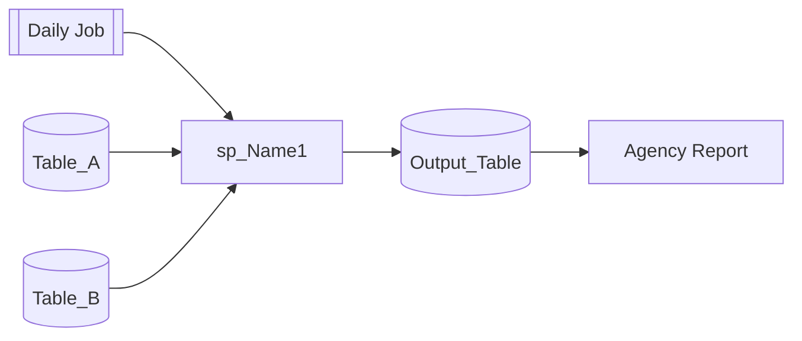
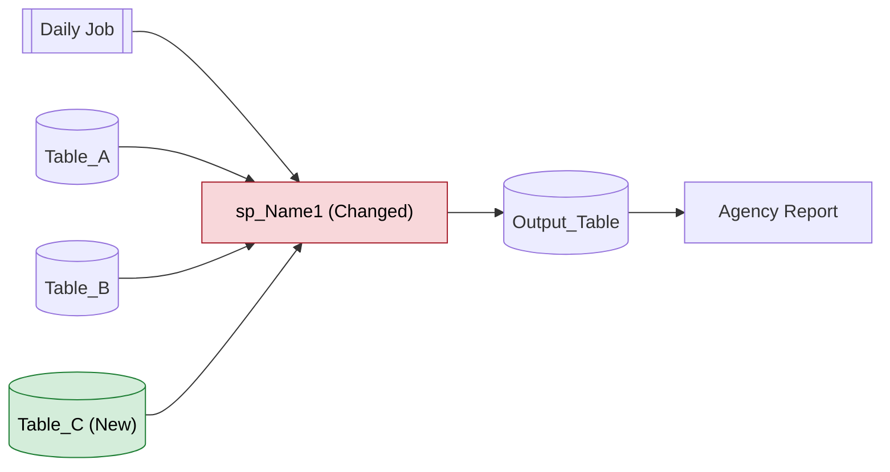
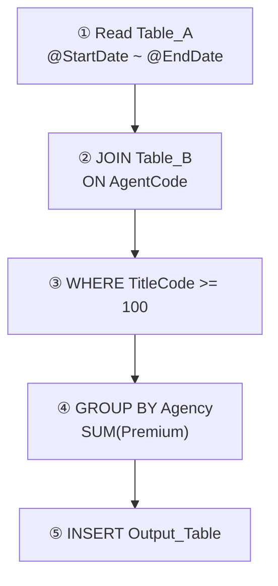
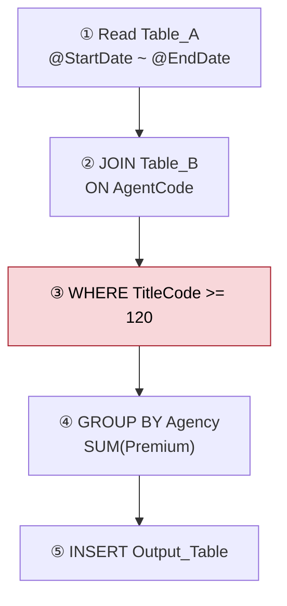
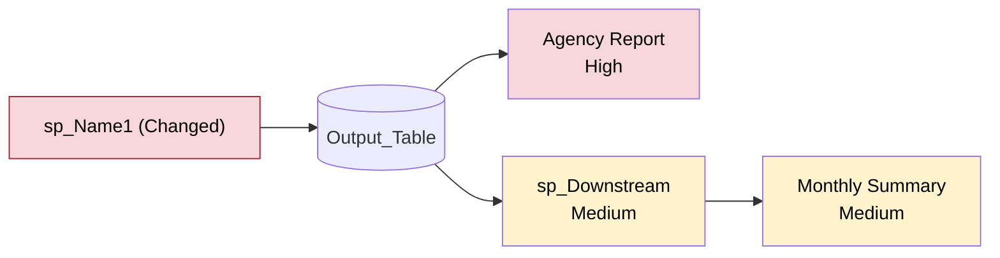
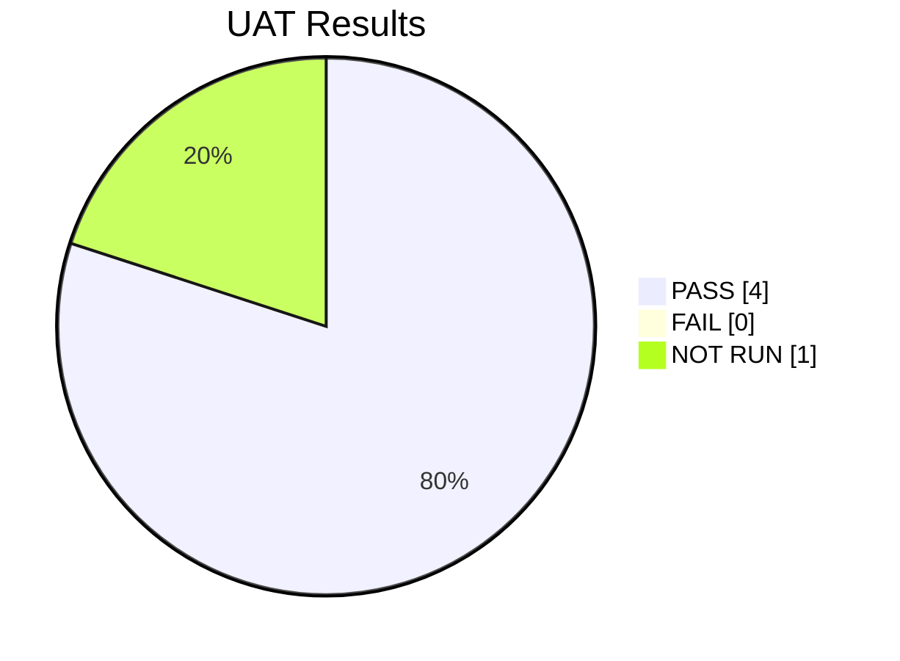

# Change Request Report

CR-<ID> — <CR Title>

| Item | Details |
|---|---|
| CR No. | CR-<ID> |
| Stored Procedures | sp_<Name1>, sp_<Name2> |
| References | CR document, NSC Transition Plan |
| Owner | <Developer> / Reviewer: <Name> |
| Date | YYYY-MM-DD |
| Status | UAT In Progress / UAT Passed / Issues Identified |

---

## 1. Executive Summary

> Problem: <One sentence on the current issue>
> Change: <One sentence on what was changed>
> Outcome: <One sentence on the result / UAT status>

| Metric | Count |
|---|---|
| Requirements | <n> |
| SPs changed | <n> |
| Change points | <n> |
| Impacted objects (SP / Job / Report) | <n> |
| Test cases | <n> (Passed <n> / Failed <n> / Not Run <n>) |

---

## 2. Requirement ↔ Change Traceability

| REQ-ID | Requirement | Change # | SP | Status |
|---|---|---|---|---|
| R01 | <Requirement description> | C01, C02 | sp_<Name1> | Completed |
| R02 | <Requirement description> | C03 | sp_<Name2> | Completed |
| — | Changes with no matching requirement | — | — | Justification required / None |

---

## 3. System Architecture

### 3.1 Before (As-Is)



### 3.2 After (To-Be)



> Legend: shaded red = changed; shaded green = new; unshaded = unchanged.

---

## 4. SP Data Flow (sp_<Name1>)

### 4.1 Before



### 4.2 After



| Step | Before | After | Changed? |
|---|---|---|---|
| ① Read data | Table_A | Table_A | — |
| ③ Filter | TitleCode >= 100 | TitleCode >= 120 | Yes |
| ⑤ Output | Output_Table | Output_Table | — |

---

## 5. Change Details

### C01 | sp_<Name1> Line <n> | R01

Reason: <Why this change is needed; cite the CR section>

```diff
- WHERE a.TitleCode >= 100
+ WHERE a.TitleCode >= 120
```

Impact: Agents with TitleCode 100–119 will no longer be included in the report.

### C02 | sp_<Name1> Line <n> | R01

Reason: <…>

```diff
- <Original SQL>
+ <Modified SQL>
```

Impact: <…>

---

## 6. Impact Analysis



| Object | How it is affected | Risk | Test required |
|---|---|---|---|
| Agency Report | Agent count will decrease | High | TC01–TC03 |
| sp_Downstream | Reads Output_Table | Medium | TC04 |
| Output columns | No change | Low | TC05 |

---

## 7. Test Results



| Test-ID | Change | Scenario | Expected | Before | After | Result | Evidence |
|---|---|---|---|---|---|---|---|
| TC01 | C01 | TitleCode = 120 | Included | Included | Included | PASS | after/TC01.csv |
| TC02 | C01 | TitleCode = 110 | Excluded | Included | Excluded | PASS | after/TC02.csv |
| TC03 | C01 | TitleCode = NULL | Excluded | Excluded | Excluded | PASS | after/TC03.csv |
| TC04 | — | Other agencies (regression) | No change | 50 rows | 50 rows | PASS | before/ vs after/ |
| TC05 | — | Output columns | No change | — | — | NOT RUN | — |

---

## 8. Risks and Rollback

| Risk | Likelihood | Mitigation |
|---|---|---|
| <Risk description> | Medium | <Mitigation> |

Rollback: Redeploy the original SP from OLD/sp_<Name1>.sql. <Rollback script location>

---

## 9. Open Items and Next Steps

| # | Item | Owner | Target Date | Status |
|---|---|---|---|---|
| 1 | <Item to confirm> | <Name> | YYYY-MM-DD | Open |
| 2 | UAT user testing | <Name> | YYYY-MM-DD | Open |
| 3 | Business sign-off | <Name> | YYYY-MM-DD | Open |

---

## 10. Sign-off

| Role | Name | Date | Signature |
|---|---|---|---|
| Developer | | | |
| Reviewer | | | |
| Business Owner | | | |
