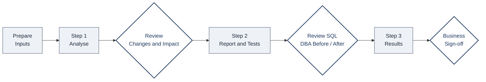

# Stored Procedure CR Workflow (Lite)

Three prompts, three checkpoints. Review each output before proceeding.

## Prepare

| Input | Save as |
|---|---|
| CR Word document and Excel attachment | CR/CR.txt, CR/CR_attachment.csv |
| Report inventory (credentials removed) | CR/report_list.csv |
| NSC transition plan | NSC_transition_plan.txt |
| Report template | REPORT/CR_Report_Template_Business.md |

## Step 1 — Analyse

1. Run: `git diff --no-index -w OLD/ SOLUTION/ > REPORT/00_raw_diff.txt`
2. Using CR/ and NSC_transition_plan.txt, create REPORT/01_changes.md:

   | C-ID | SP | Line | Before | After | REQ-ID | CR quote |

   One row per diff hunk. List changes without a requirement and
   requirements without a change.
3. Using CR/report_list.csv and DATABASE/ (max 2 levels of callers),
   add a section "Impacted Reports":

   | Report | Sheet | Changed Object Used | Business Effect | Used In |

Unsure = UNKNOWN. Do not modify OLD/ or SOLUTION/.

**Checkpoint 1:** All hunks captured, all requirements mapped, impacted reports confirmed.

## Step 2 — Report and Tests

Using REPORT/01_changes.md, OLD/, SOLUTION/ and DATABASE/:

1. Complete REPORT/CR_Report_Template_Business.md and save as
   REPORT/CR_Report.md. Formal business English, no emojis.
   Mermaid diagrams from the actual SPs, max 10 nodes, changes
   highlighted. Test results = NOT RUN.
2. Create REPORT/test_cases.md:

   | Test-ID | C-ID | Scenario | Expected (per CR) | Before | After | Result | Evidence |

   Cover normal, boundary, NULL, regression and each impacted report.
3. Create TEST/uat_queries.sql: SELECT only; per Test-ID COUNT,
   SUM and top 10 rows; label any EXEC for DBA confirmation.
   Run before and after deployment with identical data; save to
   actual_results/before/ and actual_results/after/ as <Test-ID>.csv.

**Checkpoint 2:** Queries confirmed read-only. DBA executes before deployment, deploys, executes again.

## Step 3 — Results

Read TEST/actual_results/before/ and after/. Update REPORT/test_cases.md
and section 7 of REPORT/CR_Report.md with PASS/FAIL and evidence.
Explain each FAIL with related C-ID. Update the executive summary and
recommend GO, NO-GO or CONDITIONAL.

**Checkpoint 3:** Report owners validate; Business Owner signs off CR_Report.md.

## Deliverables

| File | Step |
|---|---|
| REPORT/01_changes.md | 1 |
| REPORT/CR_Report.md | 2, 3 |
| REPORT/test_cases.md | 2, 3 |
| TEST/uat_queries.sql | 2 |
| TEST/actual_results/ | DBA |
