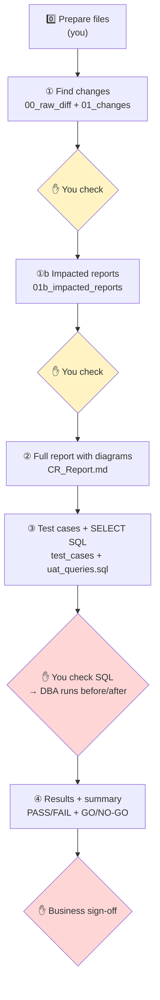

# SP Change Request — End-to-End Playbook

One CR, one folder. Run prompts in order. Check each output before the next step.

## Flow



## Folder

```text
CR-<ID>/
├── AGENTS.md
├── opencode.jsonc
├── NSC_transition_plan.txt
├── CR/          CR.txt, CR_attachment.csv, report_list.csv
├── DATABASE/    SP library (read-only)
├── OLD/         original SPs to change (read-only)
├── SOLUTION/    changed SPs
├── TEST/        uat_queries.sql, actual_results/before/, actual_results/after/
└── REPORT/      CR_Report_Template_EN.md + generated reports
```

## 0️⃣ Prepare (you, ~5 min)

- [ ] CR Word → save as CR/CR.txt
- [ ] Excel attachment inside CR → save as CR/CR_attachment.csv
- [ ] NSC transition plan Word → save as NSC_transition_plan.txt
- [ ] report_list → save as CR/report_list.csv, remove any passwords (Password= / PWD=)
- [ ] Copy CR_Report_Template_EN.md into REPORT/

## ① Find changes

```text
Run: git diff --no-index -w OLD/ SOLUTION/ > REPORT/00_raw_diff.txt
Read CR/ and NSC_transition_plan.txt. Create REPORT/01_changes.md:
| C-ID | SP | Line | Before | After | REQ-ID | CR quote |
One row per diff hunk (row count must equal hunk count).
At the end, list ⚠️ changes without a requirement,
and ⚠️ requirements without a change. Unsure = UNKNOWN.
```

✋ You check: every row correct? Any ⚠️ → ask BA / developer.

**Optional (new session):**

```text
Independent reviewer: compare REPORT/00_raw_diff.txt with
REPORT/01_changes.md. List missing hunks, wrong lines, wrong
Before/After, wrong REQ mapping. Table only. Do not modify files.
```

## ①b Impacted reports

```text
Read CR/report_list.csv and REPORT/01_changes.md.
For each changed SP and each table it writes to, find every report
whose Command Text uses it (directly, or via another SP in
DATABASE/ that calls it, max 2 levels).
Create REPORT/01b_impacted_reports.md:
| Report | Sheet | Connection | Command Text (short) | Uses which changed SP/table | How affected | Used in |
At the end: number of impacted reports, and UNKNOWN items.
```

✋ You check: UNKNOWN items especially.

## ② Full report with diagrams

```text
Fill REPORT/CR_Report_Template_EN.md using 01_changes.md,
01b_impacted_reports.md, OLD/, SOLUTION/ and DATABASE/.
Save as REPORT/CR_Report.md. Write in English.
- Sections 3–4: real Mermaid diagrams from the actual SPs,
  max 10 boxes, changed = red, new = green.
- Section 5: one `diff block per change.
- Section 6: include impacted Excel reports in diagram and table.
- Section 7: all results NOT RUN.
Unsure = UNKNOWN.
If a diagram is messy: Simplify section 3 diagrams to max 8 boxes.
```

## ③ Test cases + SELECT SQL

From CR/, CR_Report.md sections 5–6 and 01b_impacted_reports.md:

**A) REPORT/test_cases.md**

```text
| Test-ID | C-ID | Scenario | Expected (from CR) | Before | After | Result | Evidence | Report user |
Cover normal, boundary, NULL, regression, plus one case per
impacted report. Result = NOT RUN.
```

**B) TEST/uat_queries.sql**

```text
SELECT only. Per Test-ID: COUNT, SUM of key amounts, top 10 rows.
For impacted reports, reuse their Command Text; mark any EXEC
as "⚠️ EXEC – DBA to confirm".
Header comment: run BEFORE and AFTER deployment with same data
and parameters; save as actual_results/before/<Test-ID>.csv
and actual_results/after/<Test-ID>.csv.
```

✋ You check SQL → all SELECT? EXEC marked? → send to DBA.

**DBA steps:** run on old SP → save before/ → deploy new SP → run again with same data → save after/.

## ④ Results + summary

```text
Read TEST/actual_results/before/ and after/.
Update Before, After, Result (PASS/FAIL) and Evidence in
REPORT/test_cases.md, and section 7 of REPORT/CR_Report.md.
For each FAIL: what differs, which C-ID, suspected cause (hypothesis).
Update section 1 summary and recommend GO / NO-GO / CONDITIONAL
with evidence.
```

✋ Business sign-off → send CR_Report.md to report users / business owner.

## Output checklist

| File | Step |
|---|---|
| REPORT/00_raw_diff.txt | ① |
| REPORT/01_changes.md | ① |
| REPORT/01b_impacted_reports.md | ①b |
| REPORT/CR_Report.md | ② ④ |
| REPORT/test_cases.md | ③ ④ |
| TEST/uat_queries.sql | ③ |
| TEST/actual_results/before/, after/ | DBA |
