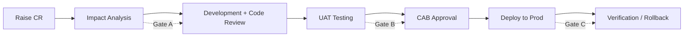

# SP Change Request SDLC Framework

> Standard process, role responsibilities and deliverable definitions for Stored Procedure change requests.
> Applies to SP modifications in Production databases, ensuring every change is traceable, auditable and reversible.

---

## 1. Executive Summary

**Problem**: SP changes currently lack a unified process. Responsibility boundaries between impact analysis, code review, UAT and deployment are unclear, making root-cause tracing difficult when something goes wrong.

**Objective**: Establish a single SDLC framework that all stakeholders follow, so every SP change has defined phases, owners, deliverables and sign-off points.

**Proposed approach**: Adopt a 7-phase workflow (CR → Impact Analysis → Development/Review → UAT → CAB → Deployment → Verification), supported by a fixed report template and Git version control.

---

## 2. Scope

### ✅ In scope

- Creation, modification and deletion of Stored Procedures in all Production databases
- Changes to SP parameters, output columns, business logic or performance tuning
- Changes to SP-derived scheduler jobs, triggers and views

### ❌ Out of scope

- Pure data fixes — follow the separate Data Change process
- Table structure changes (DDL) — follow the Schema Change process
- Experimental changes outside Production
- Formatting changes at the reporting-tool layer (SSRS / Power BI)

---

## 3. Process Flow



### Phase descriptions

| # | Phase | Purpose | Stop condition |
|---|---|---|---|
| 1 | **Raise CR** | Record business requirements and acceptance criteria | Requirement unclear → STOP |
| 2 | **Impact Analysis** | Identify affected SPs, tables, callers, jobs and outputs | Missing dependency → STOP (Gate A) |
| 3 | **Development + Code Review** | Minimal-diff change plus independent review | Not approved → STOP |
| 4 | **UAT Testing** | Verify against independent expected results | Expected results unsupported → STOP (Gate B) |
| 5 | **CAB Approval** | Change Advisory Board review | Not approved → STOP |
| 6 | **Deploy to Prod** | Execute per deploy script | No rollback plan → STOP |
| 7 | **Verification / Rollback** | Confirm outcome; roll back if required | Verification fails → immediate rollback (Gate C) |

---

## 4. Phase Responsibilities

| Phase | Owner | Deliverable | Sign-off |
|---|---|---|---|
| Raise CR | Business Owner / BA | CR document (requirements + acceptance criteria) | Business Owner |
| Impact Analysis | Dev | Affected tables / apps / jobs list, As-Is analysis | Tech Lead |
| Development | Dev | Modified SQL in SOLUTION/ + diff | Dev Lead |
| Code Review | DBA | Review record (item-by-item against requirements) | DBA |
| UAT | QA / User | Test cases + actual execution evidence | Business Owner |
| CAB Approval | Change Manager | CAB meeting minutes | CAB |
| Deployment | DBA | Deploy script + rollback script | Change Manager |
| Verification | DBA / Dev | Post-deployment verification report | Tech Lead |

> **Principle**: the same person cannot perform both "development" and "independent review". The agent may only provide recommendations; it cannot sign off on anyone's behalf.

---

## 5. Risks and Rollback

### Common risks

| Risk | Impact | Mitigation |
|---|---|---|
| Change affects unidentified callers | Other reports break | Impact analysis must list every caller (job / app / view) |
| Output column order changes | Downstream ETL or reports fail | Prohibit output schema changes without approval |
| Performance regression | Production timeouts | UAT must include execution-plan comparison |
| Data inconsistency | Figures do not reconcile | Run reconciliation checks before and after deployment |
| Failed rollback | Cannot recover | Rollback script must be rehearsed in the UAT environment |

### Rollback principles

1. **Every change must have a rollback script**, submitted together with the deploy script.
2. The rollback script must have been **actually executed** in a non-Production environment, with evidence recorded.
3. If post-deployment verification fails → **roll back immediately**; never attempt an in-place hotfix.
4. Submit an incident report within 24 hours of rollback.

### Stop conditions (STOP)

Stop immediately and escalate if any of the following apply:

- Business rules conflict or are unclear
- A required SQL dependency is missing
- The change affects UNKNOWN logic
- Tests fail twice consecutively
- The approved implementation plan cannot be followed

---

## 6. Version Control

### Baseline rules

| Item | Rule |
|---|---|
| Location | All SP source stored in a Git repo (`DATABASE/` read-only reference, `OLD/` baseline, `SOLUTION/` changes) |
| Branching | `main` mirrors Production; each CR uses a `cr/<CR-ID>` branch |
| Commit message | `CR-<ID>: <Requirement-ID> <short description>` |
| Naming | File name = SP name (for example `sp_AgencyReport.sql`); one SP per file |
| Tagging | Tag every Production deployment: `prod-YYYY-MM-DD-<CR-ID>` |
| Prohibited | No `push --force`; no rewriting deployed history |

### Folder contract

```
CR/         Business requirements (read-only)
DATABASE/   Reference DDL, other SPs, schema (read-only)
OLD/        Original baseline source (read-only, must not be modified)
SOLUTION/   Approved modified versions
TEST/       Test scripts, expected results, actual evidence
REPORT/     Phase-by-phase analysis reports
```

---

## 7. Open Decisions

| # | Question | Impact | Owner | Due |
|---|---|---|---|---|
| 1 | Is the CAB cycle weekly or fortnightly? | Affects CR scheduling | Change Manager | TBD |
| 2 | Does the UAT environment hold Production-scale data volumes? | Affects confidence in performance testing | DBA | TBD |
| 3 | Do emergency CRs follow a simplified process? | Affects incident response speed | Tech Lead | TBD |
| 4 | Should the rollback script be written by Dev or DBA? | Affects ownership | Management | TBD |
| 5 | How are legacy SPs (not yet in Git) brought into the baseline? | Affects coverage | DBA | TBD |

---

## Appendix A: Report Writing Guide

### Why it feels difficult

1. **Asking AI to write the whole report in one go** — the AI lacks company context, so the output is vague.
2. **Describing a multi-role process in prose** — Dev / DBA / QA / Approver all blur together.
3. **No conclusion up front** — readers cannot see the point.

### Correct approach

| Practice | Reason |
|---|---|
| Fix an MD template and follow it every time | Structure is consistent and nothing gets omitted |
| Draw the process with Mermaid | One diagram beats a thousand words; natively supported in Markdown |
| Use tables for roles and responsibilities | Who does what, what they deliver and who signs off is immediately clear |
| Ask AI to write one section at a time | Supply the template, your company's actual practice, and one example you are happy with |
| Finally, ask AI to act as reviewer | "Act as an IT manager reading this report and point out what is unclear" |

### The two most important sections

**Section 1 (Summary) and Section 3 (Process Flow)** — senior stakeholders usually read only these two. When they are clear, most of the report is clear.

---

## Appendix B: How to Use

1. Copy this document as `REPORT/00_framework.md` for a new CR.
2. Fill in Sections 1 and 2 with the actual situation.
3. Adjust the Mermaid flow diagram to the CR's complexity (add or remove phases).
4. Adapt the role table in Section 4 to your organisation's structure.
5. Before submitting any report, self-check against the checklist in Appendix A.

---

*Version: 1.0 | Last updated: 2026-11-14*
