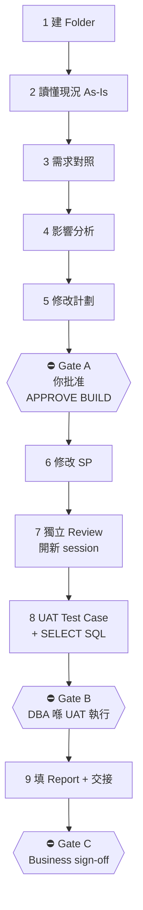

# CR 九步 Prompt 流程（9 Steps · 3 Gates）

> 一條由頭到尾嘅完整流程，共 **9 步、3 個停點**。每步都係一個獨立 prompt：做完一步、你睇完，先貼下一步。
>
> 適用：Java / SQL Server Stored Procedure / Insurance Agency Reporting 嘅 Change Request。
> 設計原則：Agent 只負責產出**可審核嘅文件**；需求審批、環境操作、UAT sign-off 同 production 部署，永遠由授權人員負責。

Version: 2026-11-16 ｜ Language: 繁體中文（Prompt 內指令為英文，方便 agent 執行）

---

## 流程總覽



| 步 | 動作 | 產出 | 停點 |
| --- | --- | --- | --- |
| 1 | 建 Folder | 6 個資料夾 + README | — |
| 2 | 讀懂現況（As-Is） | `REPORT/01_as_is.md` | — |
| 3 | 需求對照 | `REPORT/02_requirements.md` | 有問題即停，去問 BA |
| 4 | 影響分析 | `REPORT/03_impact.md` | — |
| 5 | 修改計劃 | `REPORT/04_plan_<R01>.md` | **⛔ Gate A** |
| 6 | 修改 SP | `SOLUTION/` + `REPORT/05_diff_<R01>.md` | — |
| 7 | 獨立 Review（新 session） | `REPORT/06_review.md` | — |
| 8 | UAT Test Case + SELECT SQL | `REPORT/07_uat_cases.md`、`TEST/uat_queries.sql` | **⛔ Gate B** |
| 9 | 填 Report + 交接 | `REPORT/CR_summary.md` | **⛔ Gate C** |

---

## 固定規則（每個 prompt 開頭都要加）

```text
Rules: Follow AGENTS.md. Read-only: CR/, OLD/, DATABASE/.
Never run SQL. Mark unsure items UNKNOWN. Cite file + line.
Reply in Traditional Chinese, max 1 page. STOP when done.
```

> 呢段係「護欄」：限死讀取範圍、禁止執行 SQL、要求引用檔案行號、限制回覆長度、做完即停。每次都貼，唔好慳。

---

## Step 1 — 建 Folder

```text
Create folders for <CR-001>: CR/, OLD/, DATABASE/, SOLUTION/,
TEST/, REPORT/ (with .gitkeep). Add README.md (max 10 lines)
explaining each folder. Create nothing else.
```

👉 之後你自己將 requirement 放入 `CR/`，原本嘅 SP 放入 `OLD/`。

---

## Step 2 — 讀懂現況（As-Is）

```text
Read CR/ and identify the target SP in OLD/.
Analyze ONLY that SP and its direct dependencies.

Create REPORT/01_as_is.md:
1. Mermaid flowchart: input → tables → logic → output
2. Table: | Business Rule | SQL Evidence (file+line) | CONFIRMED/INFERRED/UNKNOWN |
List parameters, source tables, JOIN/WHERE, CASE WHEN, output.
Do not propose changes.
```

---

## Step 3 — 需求對照

```text
Create REPORT/02_requirements.md:
| REQ-ID | As-Is | To-Be | Acceptance Rule | Source |
If any requirement is unclear, list questions and STOP.
```

👉 如果 agent 列咗問題，就去問 BA，攞到答案先繼續。

---

## Step 4 — 影響分析

```text
Create REPORT/03_impact.md:
| Object (SP/table/job/report) | Impact | Risk H/M/L | Evidence |
Include callers, output columns, downstream reports.
Mark missing dependencies as UNKNOWN.
```

---

## Step 5 — 修改計劃 ⛔ Gate A

```text
Create REPORT/04_plan_<R01>.md for ONE requirement only:
1. To-Be Mermaid flowchart (mark changes with ⚠️)
2. | Line | Original SQL | Proposed SQL | Reason |
3. Regression risks + rollback (= restore OLD version)
Do NOT edit SQL. Wait for: APPROVE BUILD <CR-001> <R01>
```

👉 你逐行睇清楚，啱先回覆 `APPROVE BUILD CR-001 R01`。

---

## Step 6 — 修改 SP

```text
APPROVE BUILD <CR-001> <R01>
Copy OLD/<sp_name>.sql to SOLUTION/, then apply ONLY the
approved plan. No formatting, renaming or other changes.
Show the exact diff. Create REPORT/05_diff_<R01>.md. STOP.
```

👉 如果有 R02，就返去 Step 5 再行一次，**一次只做一個 requirement**。

---

## Step 7 — 獨立 Review（一定要開新 session）

```text
Act as an independent SQL reviewer. You did not write this code.
Compare OLD/ vs SOLUTION/ against CR/ and REPORT/04_plan_*.md.
Check: unplanned changes, NULL, JOIN duplicates, boundary,
output columns, performance.
Create REPORT/06_review.md:
| # | Finding | Severity C/H/M/L | Evidence | Action |
Do not modify any file.
```

👉 如果有 Critical / High，就返去 Step 5 改計劃，**最多來回兩次**，仲唔得就停低搵人睇。

---

## Step 8 — UAT Test Case + 只查詢 SQL ⛔ Gate B

```text
From CR/ requirements (NOT from the SP output), create:
A) REPORT/07_uat_cases.md
| Test-ID | REQ-ID | Scenario | Expected | Actual | Status |
Cover normal, boundary, NULL, no-data. Status = NOT RUN.
B) TEST/uat_queries.sql
SELECT only. No INSERT/UPDATE/DELETE/EXEC/SELECT INTO.
Each query commented with Test-ID + expected result.
```

👉 **⛔ Gate B**：你自己確認晒全部係 SELECT，先交俾 DBA 喺 UAT 執行，跟住將結果放入 `TEST/actual_results/`。

> 重點：test case 一定要由 `CR/` 嘅需求倒推，唔可以由 SP 現有輸出倒推 — 否則 SP 寫錯，test case 一樣會「通過」。

---

## Step 9 — 填 Report + 交接 ⛔ Gate C

```text
Read TEST/actual_results/ and all REPORT/ files.
Update Actual + Status (PASS/FAIL) in 07_uat_cases.md.
Create REPORT/CR_summary.md (max 1 page):
# <CR-ID> <title> | Date | Status
1. 摘要（3 句）  2. 改動清單  3. 測試結果
4. 風險 / Rollback  5. 待決定 / 下一步
Recommend GO / NO-GO / CONDITIONAL with evidence.
```

👉 **⛔ Gate C**：`CR_summary.md` 交俾 Business Owner sign-off。Agent 只係俾建議，**唔可以代人批**。

---

## 試用小貼士

1. 用一個細啲嘅真實 CR，或者假資料試行一次。
2. 每步記低「agent 有冇守規則、出錯喺邊」，**3 個 CR 之後再調整 prompt**。
3. 累積幾次經驗後，可以將成套流程整理做一個 skill，以後一句「開始 CR-002」就會自動跟住呢個次序行。

---

## 同 01–07 手冊嘅關係

| 本文件（9 步 / 3 Gates） | `OpenCode_CR_Agent_01-07.md`（7 步 / 2 Gates） |
| --- | --- |
| 精簡版：每步一段可直接複製嘅 prompt | 完整版：每階段目的、動作、樣本、交付物、停條件 |
| 加入 Gate C（Business sign-off） | Gate A（計劃）、Gate B（UAT 執行） |
| 適合日常落地執行 | 適合培訓、審計、文件存檔 |

兩份可以並存：新人先讀 01–07 手冊理解全貌，日常開 CR 就跟呢份 9 步流程。
